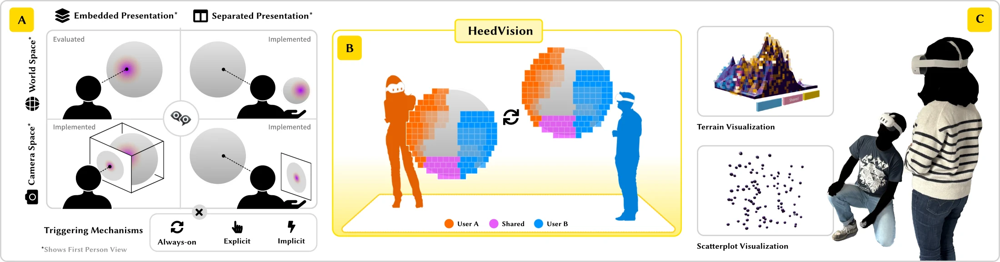

::authors

::links
- [Paper (PDF)](heedvision.pdf)
- [Talk](talk/)
- [Slides](slides/)
- [Data and code (OSF)](https://osf.io/frsp8/)



## Abstract

*Group awareness*, the ability to perceive the activities of collaborators in a shared space, is a vital mechanism to support effective coordination and joint data analysis in collaborative visualization. We introduce *collaborative attention-aware visualizations* (CAAVs) that track, record, and revisualize the collective attention of multiple users over time. We implement this concept in HeedVision, a standards-compliant WebXR system built with React Three Fiber that runs on modern AR/VR headsets, and complement it with proof-of-concept implementations covering the remaining three quadrants of our design space, varying presentation (embedded vs. separated) and situatedness (world space vs. camera space). Through a mixed-methods exploratory study where pairs of co-located analysts performed visual search tasks in a shared immersive AR environment, we investigate how attention revisualization affects collaborative coordination in immersive analytics. Our results show that CAAVs can improve spatial coordination, search efficiency, and task load distribution in collaborative visual search tasks among collaborators, though benefits vary by context, favoring abstract environments lacking natural landmarks. This work extends attention awareness to multi-user settings and provides empirical evidence for its context-dependent benefits in collaborative visual search tasks within immersive analytics environments.

## Talk

::deck

## Citation

```bibtex
@article{srinivasan2026heedvision,
  author  = {Srinivasan, Arvind and Elmqvist, Niklas},
  title   = {{HeedVision}: Attention Awareness in Collaborative
             Immersive Analytics Environments},
  journal = {IEEE Transactions on Visualization and Computer Graphics},
  year    = {2026},
  note    = {To appear. Presented at IEEE VIS 2026.},
}
```

Paper © IEEE. Supplemental materials released under CC BY 4.0.

::logos
